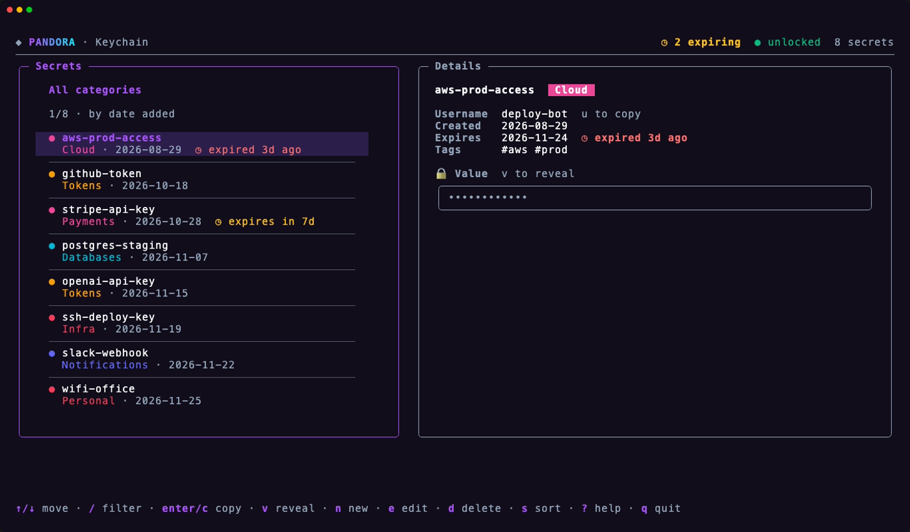
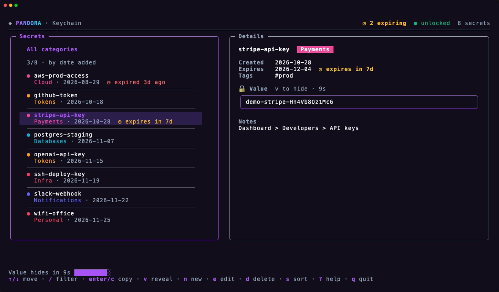
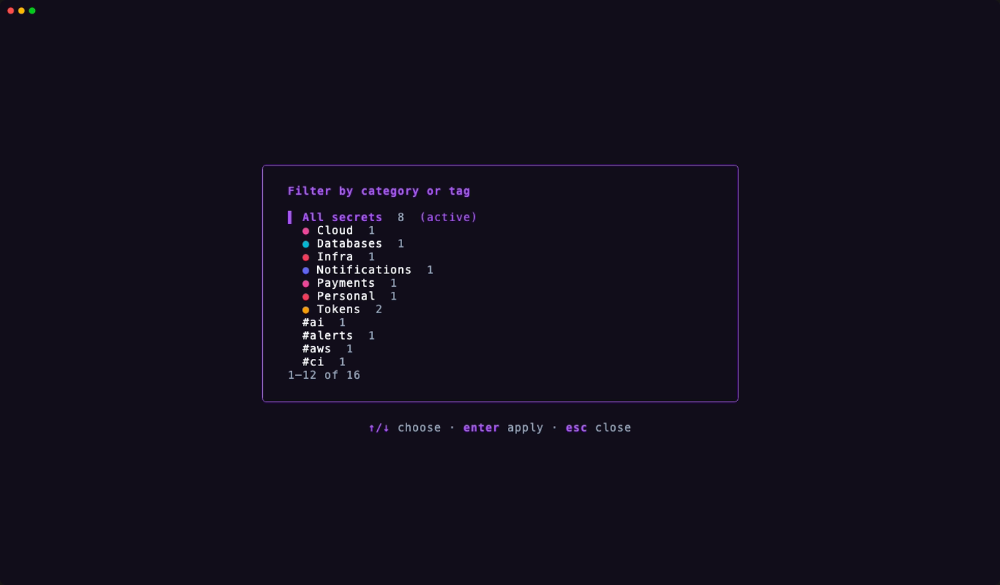
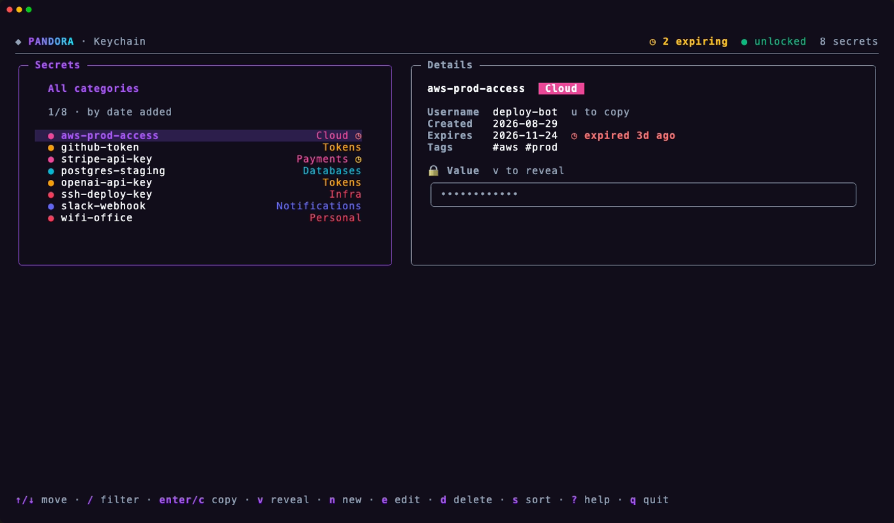
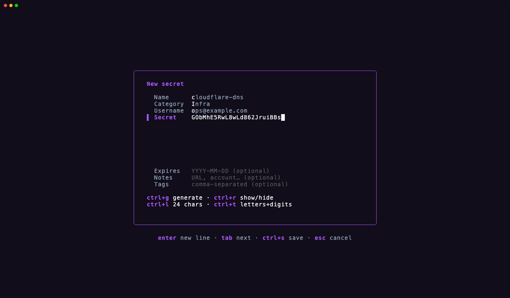
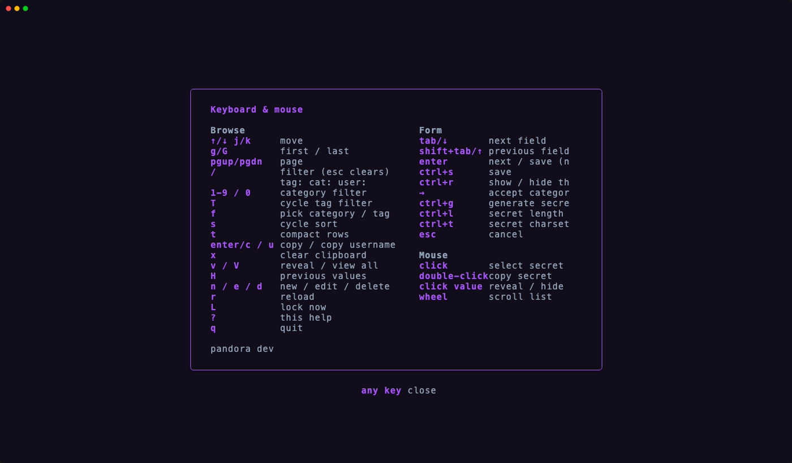

<p align="center">
  
</p>


<p align="center">
  A terminal vault for developer secrets: API keys, tokens and passwords, encrypted with a master password and backed by your OS keyring. No account, no cloud, no telemetry.
</p>

<p align="center">
  <a href="https://github.com/RafaSG13/Pandora/releases/latest"></a>
  <a href="https://github.com/RafaSG13/Pandora/actions/workflows/ci.yml"></a>
  <a href="LICENSE"></a>
  <a href="https://rafasg13.github.io/Pandora/"></a>
  
  
</p>

<p align="center">
  
</p>

<p align="center">
  
</p>

```sh
brew install RafaSG13/tap/pandora   # or: go install github.com/RafaSG13/Pandora/cmd/pandora@latest
pandora
```

Pandora keeps API keys, tokens and passwords out of dotfiles, shell history and plain-text notes. Secret **values** are stored by the OS (macOS Keychain, Windows Credential Manager, Linux Secret Service); Pandora only adds a fast interface for browsing, copying and managing them. It makes no network connections.

## Highlights

- **Encrypted and local.** Names, notes and values are encrypted with a master password (Argon2id + XChaCha20-Poly1305); values also live in the OS keyring. Single static binary, no network code.
- **TUI and scriptable CLI.** Browse and edit in the terminal UI, or use `pandora get|add|run|export|import` in scripts. `pandora run -- <cmd>` injects secrets into a command's environment.
- **Safe by default.** Masked values, clipboard cleared after 15 seconds and hidden from clipboard history on macOS and Windows, idle lock after 5 minutes.
- **Fast lookup.** Fuzzy filter with `tag:`, `cat:` and `user:` qualifiers, category and tag pickers, expiry warnings.
- **Share between machines.** Signed, peer-encrypted files with `pandora id`, `pandora peer` and `export --to`.

## Features

- **Encrypted storage** — a master password protects everything: names, notes and values are encrypted, and values also live in the OS keyring under random IDs.
- **Full management** — add, edit (including rename), delete with confirmation, and reload.
- **Rich metadata** — category (with autocomplete), user name, tags, notes or URL, and an optional expiry date with warning badges.
- **Fast lookup** — fuzzy filter over name, user name, category, tags and notes (with `tag:`, `cat:` and `user:` qualifiers), quick category filters (`1`–`9`), a category/tag picker (`f`), a tag filter (`T`), and sorting by name, category or date.
- **Safe copying** — copy to the clipboard, cleared automatically after 15 seconds (or right away with `x`), with a visible countdown; on macOS and Windows the copy is marked so clipboard history skips it.
- **Masked by default** — the value is revealed one secret at a time and hides again after 10 seconds or when you move.
- **Secret generator** — `ctrl+g` in the form fills a random password or token (length and charset selectable); `pandora gen` does the same from the shell.
- **Idle lock** — after 5 idle minutes everything is masked, the secrets are dropped from memory, a pending clipboard is cleared, and the master password is required again.
- **Orphan detection** — secrets whose keyring value is missing are flagged `!`.
- **Polished interface** — per-category colours (or none, with `NO_COLOR`), full-row selection, bordered detail card, toasts, compact mode (`t`), mouse support, and an ASCII fallback.
- **Command-line mode** — `list`, `get`, `add`, `rm`, `run`, `env`, `expiring`, `gen`, `passwd`, encrypted `export`/`import`, `doctor` and shell completions.
- **Safe vault handling** — atomic writes with a `vault.json.bak` backup; a corrupt or tampered file is reported, never overwritten.
- **Single binary, no network, no telemetry.**

## Screenshots

<table>
  <tr>
    <td width="50%" align="center"><br><sub><b>Browse</b> — per-category colours, expiry badges and the detail card</sub></td>
    <td width="50%" align="center"><br><sub><b>Reveal</b> — <code>v</code> shows one value; it hides again after 10 s or when you move</sub></td>
  </tr>
  <tr>
    <td width="50%" align="center"><br><sub><b>Filter picker</b> — <code>f</code> lists categories and tags with counts</sub></td>
    <td width="50%" align="center"><br><sub><b>Compact rows</b> — <code>t</code> switches to one line per secret</sub></td>
  </tr>
  <tr>
    <td width="50%" align="center"><br><sub><b>New secret</b> — <code>ctrl+g</code> fills a generated secret; <code>ctrl+l</code> / <code>ctrl+t</code> change length and charset</sub></td>
    <td width="50%" align="center"><br><sub><b>Help</b> — <code>?</code> lists every key, including your rebinds</sub></td>
  </tr>
</table>

<sub>Images are generated from a throwaway vault with fake secrets: <code>scripts/screenshots/record.sh</code>.</sub>

## Installation

**Homebrew** (tested on macOS; the formula also has Linux entries):

```sh
brew install RafaSG13/tap/pandora
```

**Pre-built binary.** Download the archive for your OS and CPU from the [Releases page](https://github.com/RafaSG13/Pandora/releases), check it against `checksums.txt`, and put `pandora` on your `PATH`:

```sh
shasum -a 256 -c checksums.txt --ignore-missing
tar -xzf pandora_<version>_<os>_<arch>.tar.gz
install -m 0755 pandora /usr/local/bin/pandora
```

Binaries are not code-signed or notarised yet. On macOS, Gatekeeper may block a downloaded binary: run `xattr -d com.apple.quarantine pandora` once, or build from source.

**With Go** (the version in the `go` directive of [`go.mod`](go.mod)):

```sh
go install github.com/RafaSG13/Pandora/cmd/pandora@latest
```

**From a checkout:**

```sh
git clone https://github.com/RafaSG13/Pandora.git
cd Pandora
make build          # builds bin/pandora with the version embedded
```

Check the install with `pandora --version`.

### Platform requirements

| Platform | Secret storage                                   | Clipboard                                   |
| -------- | ------------------------------------------------ | ------------------------------------------- |
| macOS    | Keychain (built in)                              | `pbcopy` / `pbpaste` (built in)             |
| Windows  | Credential Manager (built in)                    | built in                                    |
| Linux    | A running Secret Service provider (GNOME Keyring, KWallet, KeePassXC) reachable over D-Bus | `xclip`, `xsel` or `wl-clipboard` |

## Quick start

```sh
pandora
```

0. The first time, Pandora asks you to create a **master password** (at least 10 characters). It cannot be recovered. If you used an older version, your secrets are migrated to the encrypted vault at this point.
1. Press `n`, fill in a name, a category, an optional user name and the secret value (or press `ctrl+g` to generate one), and press `enter` through the optional **Expires**, **Notes** and **Tags** fields to save.
2. Move with `↑`/`↓` (or `j`/`k`), press `v` to reveal the value, `c` or `enter` to copy it.
3. Press `/` to filter, `s` to sort, `e` to edit, `d` to delete, `?` for every key, `q` to quit.

## Documentation

Full documentation lives at **[https://rafasg13.github.io/Pandora/](https://rafasg13.github.io/Pandora/)**:

- [Quick start](docs/getting-started/quickstart.md) and [keybindings](docs/reference/keybindings.md)
- [How Pandora works](docs/concepts/overview.md), [threat model](docs/security/threat-model.md), [cryptography](docs/security/cryptography.md) and [vault format](docs/security/vault-format.md)
- [Command-line guide](docs/reference/cli.md), [scripting and CI](docs/guides/scripting-and-ci.md) and [configuration](docs/reference/configuration.md)
- [Sharing secrets between machines](docs/security/sharing.md), [backup and recovery](docs/guides/backup-and-recovery.md), [importing from other tools](docs/guides/importing.md)
- [Architecture](docs/ARCHITECTURE.md), [roadmap](docs/ROADMAP.md), [contributing](CONTRIBUTING.md), [changelog](CHANGELOG.md) and [security policy](SECURITY.md)

## Command line

`pandora` with no arguments opens the interface. With a command it runs non-interactively, which suits scripts and CI. Data goes to stdout, messages and errors to stderr.

```sh
printf '%s' "$TOKEN" | pandora add github-token -c Tokens --expires 2027-01-31
pandora list --category tokens --json
pandora run -s github-token=GITHUB_TOKEN -- gh api user    # secret exists only for that command
pandora export --values -o backup.age                      # encrypted backup, prompts for a passphrase
pandora export --values --to laptop -s github-token -o github.share   # signed, encrypted for a trusted peer
```

Every command and flag: [command-line guide](https://rafasg13.github.io/Pandora/reference/cli/) and [flags](https://rafasg13.github.io/Pandora/reference/cli-flags/).

## Security at a glance

Pandora reduces accidental exposure; it does not defend against a compromised account.

- A master password is required to see anything. Names, categories, notes, dates and values are encrypted (Argon2id, XChaCha20-Poly1305); values also live in the OS keyring under random IDs.
- Values are masked until revealed, the clipboard is cleared after 15 seconds and concealed from clipboard history on macOS and Windows, and the screen locks when idle.
- No network connections, no telemetry, no logging of values.
- **Not covered:** malware running as your user, clipboard managers that ignore the concealed marker, reliable memory wiping. Lose the master password and the vault is gone.

Read the [threat model](https://rafasg13.github.io/Pandora/security/threat-model/) and the [cryptography](https://rafasg13.github.io/Pandora/security/cryptography/) before trusting it with anything important. To report a vulnerability, see [SECURITY.md](SECURITY.md).


## Development

```sh
make build   # build bin/pandora with the version embedded
make run     # run without building a binary
make vet     # go vet ./...
make test    # go test ./...
scripts/screenshots/record.sh   # regenerate assets/demo*.gif and assets/screenshots (needs vhs)
go run ./scripts/docsgen        # regenerate docs/reference/cli-flags.md after changing a command
pip install -r requirements-docs.txt && mkdocs serve   # preview the documentation site
```

Tests use an in-memory keyring and a temporary config directory; they never touch your real secrets. See [CONTRIBUTING.md](CONTRIBUTING.md).

## Built with

[Bubble Tea](https://github.com/charmbracelet/bubbletea), [Bubbles](https://github.com/charmbracelet/bubbles), [Lip Gloss](https://github.com/charmbracelet/lipgloss), [go-keyring](https://github.com/zalando/go-keyring), [age](https://github.com/FiloSottile/age) and [atotto/clipboard](https://github.com/atotto/clipboard).

## License

[MIT](LICENSE)
