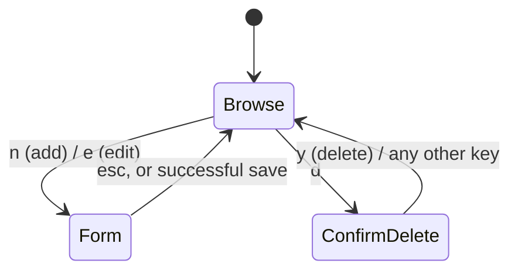

# Architecture

## Packages

| Package          | Responsibility |
| ---------------- | -------------- |
| `cmd/pandora`    | Entry point. Starts the Bubble Tea program on the alternate screen with `tui.New()`; prints errors to stderr and exits 1. |
| `internal/tui`   | The interface, split by Bubble Tea role (below). Talks to storage only through `store`. |
| `internal/store` | Keyring access and the metadata file. No UI dependencies. |

### `internal/store`

| Function | Behaviour |
| -------- | --------- |
| `SaveSecret(meta, value)` | Fails with `ErrExists` if the title is recorded. Writes the keyring value, then the metadata; if the metadata write fails the keyring entry is rolled back. |
| `GetSecretValue(title)` | Reads the value from the keyring. |
| `UpdateSecret(old, meta, newValue)` | Changes name/category and, when `newValue != nil`, the value. `Created` is preserved. Renaming: set new keyring entry → write metadata → delete old entry (rolls back the new entry if the metadata write fails). `ErrNotFound` / `ErrExists` for a missing source / taken target. |
| `DeleteSecret(title)` | Deletes the keyring entry (already missing is fine), then the metadata entry. `ErrNotFound` if not recorded. |
| `LoadMetadata()` | Reads `metadata.json`; missing file → empty list; collapses duplicate titles from older versions (last wins). Invalid JSON is an error. |

Metadata writes go through a temp file in the same directory and `os.Rename`, so a crash cannot leave a half-written file. Every mutating function loads metadata first and aborts on error, so a corrupt file is never overwritten.

### `internal/tui`

| File        | Contents |
| ----------- | -------- |
| `model.go`  | `model` state, list `item`, `mode`, `New()`, `reload`, pane/modal width helpers |
| `update.go` | `Update`, `openForm`, `updateForm`, `saveForm`, `updateConfirmDelete`, `setFocus` |
| `view.go`   | `View` and the `render*` helpers (header, panes, detail, form, delete dialog, status, help) |
| `styles.go` | Adaptive colour palette (`accent`, `subtle`, `success`, `danger`, `text`) and lipgloss styles |
| `category.go` | Category palette, stable hash → colour, category badge |
| `delegate.go` | List row renderer: category bar, selected-row background, truncation, filter-match underline |

**Modes.** `model.mode` decides what the keyboard drives:



While the list filter is active, browse-mode keys go to the list unchanged. Any key press clears the status line before it is handled. Failed saves keep the form open so nothing typed is lost.

**Single source of truth.** After every mutation (add, edit, delete, `r`) the model calls `reload(selectTitle)`, which re-reads `LoadMetadata()` and calls `list.SetItems`; it never patches the list by index, so an active filter cannot cause the wrong item to change. `reload` restores the selection by title.

**Layout.** Computed from the last `tea.WindowSizeMsg`: the list pane gets `max(30, (w-6)*45/100)` columns, the detail pane the rest (6 = two borders per pane plus a 2-column gap). Styles carry no fixed widths; widths are applied at render time. Vertical budget: header (1) + rule (1) + panes (`h-4` including borders) + status (1) + help (1) = `h`. Add/edit/delete dialogs are centred with `lipgloss.Place` with the help line beneath. On narrow terminals the footer drops the least important hints first.

## Data flow

### Save (add or edit)

```mermaid
sequenceDiagram
    participant U as User
    participant T as tui.saveForm
    participant S as store
    participant K as OS keyring
    participant F as metadata.json
    U->>T: enter on last field
    T->>T: validate (name; secret when adding)
    T->>S: SaveSecret / UpdateSecret
    S->>F: LoadMetadata (duplicate check)
    S->>K: Set(service, title, value)
    S->>F: atomic write
    S-->>T: nil / ErrExists / error
    T->>S: reload via LoadMetadata
    T->>T: status "✓ Saved" / "✓ Updated", or error with form kept open
```

### Delete

`d` → confirmation dialog → `y` → `store.DeleteSecret` → `reload` → `✓ Deleted "<name>"`. Any other key cancels with no side effects.

### Copy

`enter`/`c` → `store.GetSecretValue(title)` → `writeClipboard(value)` (a variable, so tests can fake the clipboard). On success the model sets `clipLeft = 15`, increments `copyGen`, and starts a 1 s `tea.Tick` that delivers `clipboardTickMsg{gen}`. Each tick decrements `clipLeft`, the footer shows `✓ Copied · clears in Ns` with a draining bar, and at zero the clipboard is overwritten with an empty string.

- A tick whose `gen` differs from `copyGen` is ignored, so a second copy restarts the countdown and cannot be cut short by the first one.
- `x` clears immediately and bumps `copyGen`, cancelling the countdown, so a later clipboard content from the user is never wiped by a stale tick.
- `q`/`ctrl+c` clears a pending value before quitting (the countdown would otherwise die with the process).
- Errors are reported in the status line: `✗ Could not read secret`, `✗ Could not copy: …`, `✗ Could not clear clipboard: …`; no countdown starts if the copy failed.

### Reveal

`v` reveals the **selected** secret (`model.revealed` holds its title) and starts a 10 s timer (`hideRevealMsg{gen}`; `revealGen` invalidates stale timers). Pressing `v` again hides it. After every message `Update` checks the selection: if it no longer matches `revealed` (cursor moved, item renamed, deleted, reloaded away) the value is hidden, so returning to an item never shows it again without a new `v`. While revealed, `renderDetail` fetches the value from the keyring on every render; on error the masked value stays.

## Persisted data

`<os.UserConfigDir()>/pandora/metadata.json` (directory `0700`, file `0600` on Unix; Windows has no POSIX modes and relies on the user profile ACLs) holds a JSON array of `store.SecretMeta`:

```json
[
  {
    "title": "githubToken",
    "category": "TOKENS",
    "created": "2026-11-15"
  }
]
```

| Field      | Type   | Meaning |
| ---------- | ------ | ------- |
| `title`    | string | Secret name, unique; also the keyring account |
| `category` | string | Free-form label |
| `created`  | string | `YYYY-MM-DD` creation date |

Secret values are stored only in the OS keyring, service `pandora-cli`. The JSON field names are a persisted format: changes must be backwards compatible (a missing field must have a sensible default).

## Testing

Tests replace the keyring with `keyring.MockInit()` and point `HOME`, `XDG_CONFIG_HOME` and `AppData` at a temp dir, so nothing touches the real keychain or config. `internal/tui` tests drive `Update` with key messages and assert on model state and store contents.

## Known limitations

- A secret deleted or renamed by another Pandora instance is only noticed after `r` (reload); acting on it fails with a status message.
- Two concurrent instances can race on `metadata.json` (last writer wins).
- Below 60×18 the UI shows a "Terminal too small" notice instead of the layout.
