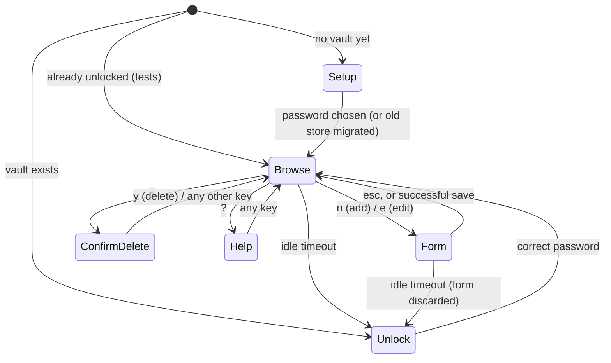

# Architecture

## Packages

| Package          | Responsibility |
| ---------------- | -------------- |
| `cmd/pandora`    | Entry point. With arguments it runs `cli.Run`; without, it starts the Bubble Tea program (alternate screen, mouse cell motion) with `tui.New()`. Errors go to stderr, exit code 1. |
| `internal/cli`   | Non-interactive subcommands (`list`, `get`, `add`, `rm`, `run`, `env`, `expiring`, `gen`, `passwd`, `export`, `import`, `doctor`, `version`, `completion`). Takes its streams as arguments and returns an exit code; never calls `os.Exit`. |
| `internal/tui`   | The interface, split by Bubble Tea role (below). Talks to storage only through `store`. |
| `internal/store` | The encrypted vault, the session key, and keyring access. No UI dependencies. |
| `internal/gen`   | Random secrets (`crypto/rand`): charsets, preset lengths, `Generate`. Used by the form and `pandora gen`. |
| `internal/config` | `config.json` (next to `vault.json`): `Load` merges built-in defaults, the file and `PANDORA_LOCK_MINUTES` / `PANDORA_ASCII` into `Settings` (environment > file > default) and returns warnings instead of failing. No UI or store dependency. Used by the TUI (`New`) and the CLI (`gen`, `config`). |
| `internal/version` | Version, commit and date: set with `-ldflags -X` by the release build, falling back to `runtime/debug.ReadBuildInfo` (pseudo-versions of untagged builds report `dev`). |

### `internal/store`

| Function | Behaviour |
| -------- | --------- |
| `Exists`, `LegacyExists`, `IsUnlocked` | Is there a `vault.json`, an old plain-text `metadata.json`, a held session key. |
| `Create(pw)`, `Unlock(pw)`, `Lock()`, `ChangePassword(old, new)` | Master-password lifecycle. The data key lives in a package-level session; every function below returns `ErrLocked` without it. `Unlock` on a wrong password returns `ErrWrongPassword`. Passwords need `MinPasswordLen` (10) runes. |
| `MigrateLegacy(pw)` | Converts the plain-text store; on any failure the old files and keyring entries stay untouched. A `*CleanupError` means the vault is complete but some old data could not be removed. |
| `SaveSecret(meta, value)` | Validates text, fails with `ErrExists` if the title is recorded and `ErrValueTooLarge` above `MaxValueBytes` (32 KB). Writes the sealed value, split into keyring entries, under a new random id, then the vault; if the vault write fails the entries are rolled back. |
| `GetSecretValue(title)` | Maps the title to its id, reads every keyring entry of the value and decrypts it. An unknown title or a missing entry returns `keyring.ErrNotFound`. |
| `UpdateSecret(old, meta, newValue)` | Replaces name, category, expiry and notes and, when `newValue != nil`, the value. `Created` is preserved and `Updated` is set to today. A rename only rewrites the vault: the keyring entries keep their id. A new value is written under a fresh id and the old entries are removed only after the vault points at the new ones, so a failure never leaves a half-replaced value. `ErrNotFound` / `ErrExists` for a missing source / taken target; `ErrValueTooLarge` above 32 KB. |
| `DeleteSecret(title)` | Deletes every keyring entry of the value (already missing is fine), then the vault record. `ErrNotFound` if not recorded. |
| `LoadMetadata()` | Decrypts the vault; missing vault → empty list; collapses duplicate titles (last wins). Corrupt data is an error. |
| `MissingValues()` | Titles whose keyring value is missing (used by `pandora doctor`). |
| `SetHistoryDepth(n)`, `Versions`, `VersionCounts`, `GetVersion`, `RestoreVersion`, `MissingVersions`, `DropMissingVersions` | Value history (`history.go`). `SetHistoryDepth` is set once from `history_depth` (TUI `New`, CLI `import`); without it nothing is kept. `UpdateSecret` and `RestoreSecrets` write the new value under a fresh id and, when the old value is readable and differs, push it on the record's history; versions beyond the depth are removed from the keyring only after the vault write, and a failed vault write removes just what the call stored. Setting the same value changes nothing. `RestoreVersion(title, back)` swaps the current value with the `back`-th previous one (the replaced value goes on top) by rewriting only the vault. `DeleteSecret` drops every version. `back` 1 is the newest previous value. |
| `InspectVault(password)`, `RestoreVaultBackup(password)`, `BackupExists()` | Vault-file recovery (`recover.go`). `InspectVault` classifies `vault.json` and `vault.json.bak` as `FileOK` / `FileMissing` / `FileCorrupt` / `FileNewer` / `FileWrongPassword` without a session. `RestoreVaultBackup` copies the verified backup over vault.json only when the password opens the backup and vault.json is missing or corrupt (`ErrWrongPassword`, `ErrRestoreNotNeeded`, `ErrNoUsableBackup`, `ErrRestoreRefused` otherwise); it keeps the damaged file as `vault.json.corrupt`, leaves the `.bak` byte for byte, and writes under the vault lock. Damage anywhere in parsing or decryption wraps `ErrVaultCorrupt`. |
| `RestoreSecrets(...)` | Batch import: values first (each under a fresh id), then one vault write; the entries a replaced value used are removed only after that write, and everything the batch stored is removed again if it fails. |
| `ParseDate`, `SecretMeta.DaysUntilExpiry` | `YYYY-MM-DD` handling shared by the form, list badges and CLI. |

Vault writes go through a temp file in the same directory and `os.Rename`, so a crash cannot leave a half-written file; the previous contents are first copied to `vault.json.bak`. Every mutating function decrypts the vault first and aborts on error, so a corrupt or tampered file is never overwritten.

**Concurrency.** Every function that writes (`Create`, `ChangePassword`, `MigrateLegacy`, `SaveSecret`, `UpdateSecret`, `DeleteSecret`, `RestoreSecrets`) holds an exclusive OS file lock (`flock`, `LockFileEx` on Windows) on `vault.lock` for its whole load → keyring write → save cycle, so concurrent processes serialize instead of overwriting each other. The kernel drops the lock when a process dies, so there is no stale-lock cleanup; `vault.lock` is never deleted. Waiting is polled up to 10 s, then the write fails with `ErrBusy` having changed nothing. Reads (`LoadMetadata`, `GetSecretValue`, `MissingValues`) never lock: the vault is replaced atomically, so they see a complete version. `VaultStamp()` (modification time and size of `vault.json`) lets a front end detect changes cheaply.

### `internal/cli`

`cli.Run(args, stdin, stdout, stderr) int` looks the command up in one table (`registry.go`: name, summary, flags with value hints, positional kind) and calls its handler, each with its own `flag.FlagSet`. The same table builds the usage text and the bash/zsh/fish/PowerShell completion scripts (`completion.go`); a test runs `<cmd> -h` for every command and fails if the table's flags drift from the real ones. The hidden `__complete titles|categories` helper feeds completions and prints names only, never values, and stays silent on any error. Exit codes: `0` ok, `1` runtime error, `2` usage error, `3` `expiring` found expired or expiring secrets (not an error: stdout still carries the list). `export --values` encrypts with age (scrypt passphrase recipient, armored); `export` without `--values` is plain JSON without values. `import` reads Pandora's own export or, with `--format`, a foreign plain-text file through one pure parser per format (`importers.go`: `dotenv`, `bitwarden-json`); every format ends in `normalizeSecret` (the same checks as `parseExport`) and one `RestoreSecrets` batch, and `--dry-run` simply stops before that write. `run` injects secrets into the child's environment only and forwards signals. Secret values are printed only by `get` (and generated ones by `gen`, which stores nothing).

**Unlock.** Every command that reads or writes secrets (`list`, `get`, `add`, `rm`, `run`, `env`, `expiring`, `doctor`, `export`, `import`) calls `app.unlock()` after flag parsing: `PANDORA_MASTER_PASSWORD` if set (with a one-time warning), else a hidden prompt (3 attempts) on a terminal, else exit 1. With no vault yet it creates one (or runs `store.MigrateLegacy` when an old `metadata.json` exists), but only on a terminal. `gen`, `version`, `help` and `completion` never unlock; `__complete` unlocks silently and only from the environment variable. `passwd` always asks for the current password.

### `internal/tui`

| File          | Contents |
| ------------- | -------- |
| `model.go`    | `model` state, list `item`, `mode`, `New()`, `Init`, `reload` (category filter + sort), pane geometry, scroll clamping, orphan check command |
| `update.go`   | `Update` (scroll/reveal bookkeeping around `update`), the 1 s `tick`, key and mouse handling, form (`openForm`, `updateForm`, `saveForm`), delete confirmation, lock |
| `view.go`     | `View` and the `render*` helpers: header, panes, list crop + scrollbar, detail card, toast overlay, countdowns, form, help overlay, welcome / error state, footer |
| `delegate.go` | `rowDelegate`: roomy (3-line) and compact (1-line) list rows, selection fill, orphan / expiry markers |
| `styles.go`   | Adaptive palette, per-category colours (`categoryColor`), gradient, pane tag border |
| `icons.go`    | `glyphSet`: Unicode glyphs and the ASCII fallback (`PANDORA_ASCII=1` or a non-UTF-8 locale); `detectNoColor` / `applyColorMode` (`NO_COLOR` or `TERM=dumb`: forces the Ascii colour profile and adds a selection marker) |
| `expiry.go`   | `expiryInfo`: label and level (`far` / `soon` within `expiry_warn_days` / `expired`) for a secret |

**Modes.** `model.mode` decides what the keyboard drives:



**Master password.** `modeUnlock` and `modeSetup` own the keyboard until `store.Unlock` / `store.Create` / `store.MigrateLegacy` succeeds. The key derivation runs in a `tea.Cmd` off the UI thread (`unlockCmd` → `unlockedMsg`) with a spinner; input is ignored meanwhile except `ctrl+c`. `lock()` calls `store.Lock()` and empties the list, filters, form inputs and password fields, so no title stays in the model; unlocking always returns to Browse. While the list filter is active, browse-mode keys go to the list unchanged. Any key press clears the status message before it is handled. Failed saves keep the form open so nothing typed is lost.

**Single source of truth.** After every mutation (add, edit, delete, `r`, `s`, category change) the model calls `reload(selectTitle)`, which re-reads `LoadMetadata()`, applies the category filter and sort, and calls `list.SetItems`; it never patches the list by index. `reload` restores the selection by title (or the new last row when the selected one was the last and is gone) and records the vault's `store.VaultStamp()`. Each tick compares that stamp with the file's: when another process changed the vault and the model is browsing, it reloads and restarts the orphan check; in a form or delete confirmation it waits until the dialog closes.

**Time.** One `tickMsg` per second (started in `Init`) drives everything time-based: reveal auto-hide, the clipboard deadline, toast expiry and the idle lock. State holds *deadlines* (`revealUntil`, `clipUntil`, `toastUntil`, `lastActive`), never per-action timers, so a second copy cannot be cleared by the first copy's timer. `model.now` is injectable for tests.

**Reveal.** Only `revealTitle` is shown, until `revealUntil`. `Update` clears it whenever the selected title differs.

**Clipboard.** `writeSecretClipboard`, `writeClipboard` and `readClipboard` (variables, stubbed in tests) are the only clipboard access. Copying a secret uses `writeSecretClipboard` (= `secretclip.Write`, `internal/secretclip/clipboard.go`, per-OS `clipboard_<os>.go`; the CLI's `get --copy` calls the same function through `app.copySecret`), which marks the entry for clipboard managers: macOS runs `/usr/bin/osascript` with a JXA script (value on stdin, never argv) that sets the text plus `org.nspasteboard.ConcealedType`; Windows sets `CF_UNICODETEXT` plus `ExcludeClipboardContentFromMonitorProcessing`, `CanIncludeInClipboardHistory` = 0 and `CanUploadToCloudClipboard` = 0 via `golang.org/x/sys/windows` (no cgo); other systems write plainly. If the marked write fails before the text is set, it falls back to a plain `atotto/clipboard` write. Reads and clears use `readClipboard`/`writeClipboard("")` (atotto). Failures are reported instead of showing `✓ Copied`. Copying stores a SHA-256 of the value (`clipHash`), never the value. Clearing (deadline, `x`, lock) reads the clipboard first and clears only when it still matches (trailing newlines ignored); a read error clears anyway, and content that no longer matches is left alone (`x` says so; the automatic paths are silent). The lock screen clears a pending clipboard the same way.

**Orphans.** After unlock and on `r`, the model runs `checkOrphans` off the UI thread (some keyring backends are slow or prompt); the result (`orphanMsg`) marks rows and the detail card of secrets whose value is missing. A spinner shows in the header meanwhile. A result arriving while locked is dropped.

**Secret field.** The form's secret is a `bubbles/textarea` (`model.secret`; `inputs[fieldSecret]` is an unused slot kept so the other fields keep their indices), because `textinput` cannot hold newlines. `enter` inserts a newline there, `tab` moves on, `ctrl+s` saves, and `up`/`down` move through its lines before leaving the field. The textarea's own 99-row and 500-column caps are lifted (they would silently cut keys and tokens); `store.MaxValueBytes` is the limit. It cannot mask, so while the text is not shown (`ctrl+r`) the form draws bullets per line (`maskedLines`) from `Value()`. Its height is `clamp(h-18+1, 1, 8)`, which is what keeps the form exactly the window height at 60×18. A reveal reads the value once (`revealValue`, dropped on hide, expiry and lock) instead of on every frame.

**Layout.** Computed from the last `tea.WindowSizeMsg`: the list pane gets `max(30, (w-6)*45/100)` columns, the detail pane the rest (6 = two borders per pane plus a 2-column gap). Panes fit their content: outer height `clamp(listChrome + n*rowHeight + 4, minPaneOuter, h-4)`, top-aligned, with the status row and footer pinned to the bottom, so the view is always exactly `h` lines. Below 60×18 the view is replaced by `Terminal too small`. The list is a bubbles `list.Model` sized to hold every item on one page; `listView` crops its rendered lines to a window starting at `model.scroll` (the wheel changes only that offset, never the selection), replaces the status bar text with the position indicator, and appends the scrollbar. Toasts are composed over the bottom-right of the detail pane with `ansi.Truncate`/`TruncateLeft`.

**Mouse geometry.** Click hit-testing uses `listTopRow` (8) and the row height; `TestClickGeometryMatchesRenderedList` and `TestCompactRowsGeometry` fail if the rendered list moves.

## Data flow

### Save (add or edit)

```mermaid
sequenceDiagram
    participant U as User
    participant T as tui.saveForm
    participant S as store
    participant K as OS keyring
    participant F as vault.json
    U->>T: enter on last field / ctrl+s
    T->>T: validate (name; secret when adding; expiry date)
    T->>S: SaveSecret / UpdateSecret
    S->>F: loadRecords (decrypt, duplicate check)
    S->>K: Set(service, id, sealed value)
    S->>F: re-encrypt with a fresh nonce, backup, then atomic write
    S-->>T: nil / ErrExists / error
    T->>S: reload via LoadMetadata
    T->>T: toast "✓ Saved" / "✓ Updated", or error with form kept open
```

### Delete

`d` → confirmation dialog → `y` → `store.DeleteSecret` → `reload` → `✓ Deleted "<name>"`. Any other key cancels with no side effects.

### Copy

`enter`/`c` → `store.GetSecretValue(title)` → `writeSecretClipboard(value)`; on success `clipUntil = now + 15 s`, `clipHash` records the value's hash and a countdown bar appears. The tick clears the clipboard when the deadline passes (see *Clipboard* above); `x` clears it immediately. A new copy simply moves the deadline and the hash.

## Persisted data

`<os.UserConfigDir()>/pandora/vault.json` (directory `0700`, file `0600` on Unix; Windows has no POSIX modes and relies on the user profile ACLs):

```json
{"version": 2,
 "kdf": {"alg": "argon2id", "salt": "<b64 16 B>", "time": 3, "memory_kib": 65536, "threads": 4},
 "wrapped_key": "<b64 nonce24 || ciphertext>",
 "data": "<b64 nonce24 || ciphertext>"}
```

- `wrapped_key` is a random 32-byte data key sealed with XChaCha20-Poly1305 under the key Argon2id derives from the master password (AAD `pandora-v2-key`). A failed open is "wrong password".
- `data` is the same AEAD under the data key (AAD `pandora-v2-meta`, fresh nonce on every write) over a JSON array of records `{id, chunks?, title, category, created, updated?, expires?, notes?, tags?}`. `id` is 32 lowercase hex characters from `crypto/rand`; it is the keyring account of the first piece of the value. `chunks` is the number of keyring entries and is omitted for one, so records written before multi-line values load unchanged. `tags` is omitted when empty, so records written before tags existed load unchanged and a secret without tags still writes the old shape.
- `history` (omitted when empty, so older vaults load unchanged and a secret that never changed writes the old shape) is the list of previous values, newest first: `{id, chunks?, replaced}`. Each points at the keyring entries the value had when it was current; they are encrypted under the same data key with their own `id` as AAD, so nothing is copied or re-encrypted when a value is replaced or restored. A version of Pandora that does not know the field drops it on its next write and leaves those entries in the keyring unreferenced.
- KDF parameters are read from the file, which is untrusted input: `alg` must be `argon2id`, `time` 1–10, `memory_kib` 8–1048576, `threads` 1–16, otherwise the file is rejected before any key derivation.
- Keyring values are `pv2:` + base64(nonce24 || XChaCha20-Poly1305(dataKey, value, AAD = id)). Binding the id stops ciphertexts being swapped between entries. The string is split into pieces of at most 2000 characters, stored as accounts `<id>`, `<id>.1`, `<id>.2`, … because the OS keyrings cap one entry (Windows Credential Manager 2560 bytes; macOS about 4 KB per `security` command after go-keyring's own base64). The AAD covers the whole concatenation, so reordered, truncated or foreign pieces fail to decrypt.
- A corrupt or tampered `data` field is an error and is never overwritten. `vault.json.bak` holds the previous (still encrypted) version.
- Titles, categories, notes and tags must not contain control characters (`store.ValidateText`), so imported files cannot inject terminal escape sequences. Writers (`SaveSecret`, `UpdateSecret`, `RestoreSecrets`) normalise tags through `store.NormalizeTags` (trim, lowercase, drop empties and duplicates, sort; no whitespace or commas inside, at most 24 characters, at most 10); `parseExport` does the same before anything is written.
- Tags are additive: the vault stays at version 2. An older Pandora opens the file and ignores `tags`, but its next write drops them, so downgrading after using tags loses them.

`store.SecretMeta` (`title`, `category`, `created`, `updated`, `expires`, `notes`, `tags`) is still the shape used by `export`/`import` and by the callers; the id exists only inside the store:

| Field      | Type   | Meaning |
| ---------- | ------ | ------- |
| `title`    | string | Secret name, unique |
| `category` | string | Free-form label |
| `created`  | string | `YYYY-MM-DD` creation date |
| `updated`  | string | Optional; set on every edit |
| `expires`  | string | Optional `YYYY-MM-DD`; drives the warning badges |
| `notes`    | string | Optional free text (e.g. a URL); never put values here |
| `tags`     | []string | Optional; normalised (see above); filtered by `T` in the TUI and `--tag` in the CLI |

Secret values are stored only in the OS keyring, service `pandora-cli`, encrypted as above. Older versions used `metadata.json` plus keyring accounts named after the titles; `store.MigrateLegacy` converts that on first start (re-encrypting each value under a fresh id, then deleting the old accounts and files; removal is not secure erasure on SSD/APFS).

## Testing

Tests replace the keyring with `keyring.MockInit()`, point `HOME`, `XDG_CONFIG_HOME` and `AppData` at a temp dir, call `store.FastKDFForTests()` (cheap Argon2 parameters; tests only), create a vault and unlock it, and stub `writeClipboard` / `writeSecretClipboard` / `readClipboard`, so nothing touches the real keychain, config or clipboard. The CLI harness locks the store before every run so each invocation behaves like a new process. `internal/tui` tests drive `Update` with key, mouse and tick messages (with an injected clock) and assert on model state, store contents and the rendered view. The single exception is `internal/store/integration_test.go` (build tag `integration`, and it also needs `PANDORA_INTEGRATION=1`): it talks to the real OS keyring and only runs in the Linux CI job, inside a throwaway D-Bus session. Release QA on real keychains and terminals is a manual checklist: [QA.md](QA.md).

## Known limitations

- A change made by another process is detected by polling the size and modification time of `vault.json` once per tick. A file system with one-second timestamps could hide a same-size change made within the same second; `r` always reloads. A secret renamed or deleted elsewhere while you are editing it fails with a status message on save.
- The revealed value in the detail card shows only its first lines when it does not fit (`c` copies all); there is no scrolling inside the card. Values are text only, up to 32 KB; there is no binary value type.
- The write lock is advisory: it protects against other Pandora processes, not against something editing `vault.json` or the keyring by hand. It needs a local file system with working `flock` / `LockFileEx` semantics; on a network share, locking may not exclude other machines.
- go-keyring cannot enumerate entries, so `doctor` finds vault entries without a value but not keyring entries without a vault record. A restored backup predates the last change: values stored by that change stay in the keyring unreferenced, and a value that change replaced is gone, so its entry is reported as missing.
- The master password cannot be recovered; `export --values` is the backup route.
- `ChangePassword` re-wraps the same data key, so someone who knew the old password and kept an old copy of `vault.json` (not the `.bak`, which is replaced) can still open that old copy. Rotating the data key would need every keyring value re-encrypted.
- The concealed clipboard marker only helps with clipboard managers that honour it; Linux has no convention, so copies there are plain. On macOS each copy starts `osascript` (~100 ms); if it fails, the copy falls back to an unmarked write.
- Selecting text with the mouse needs `Shift` (`Alt` in some terminals) because Pandora captures the mouse.
