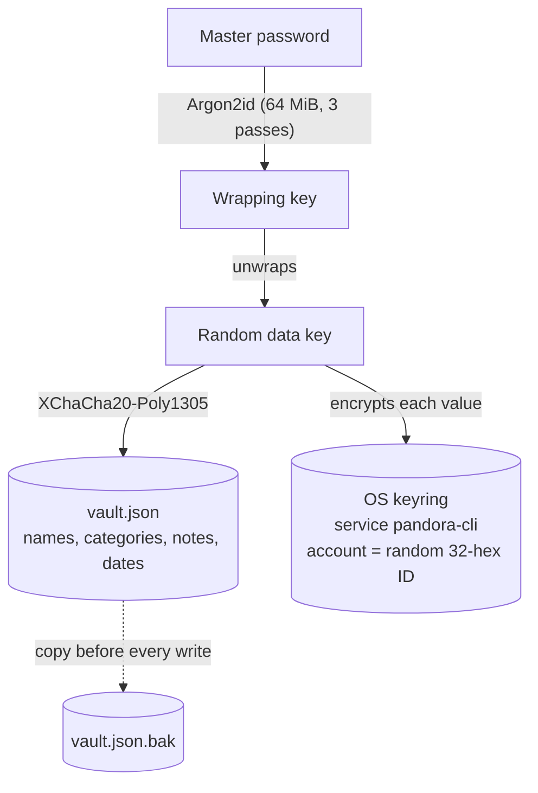
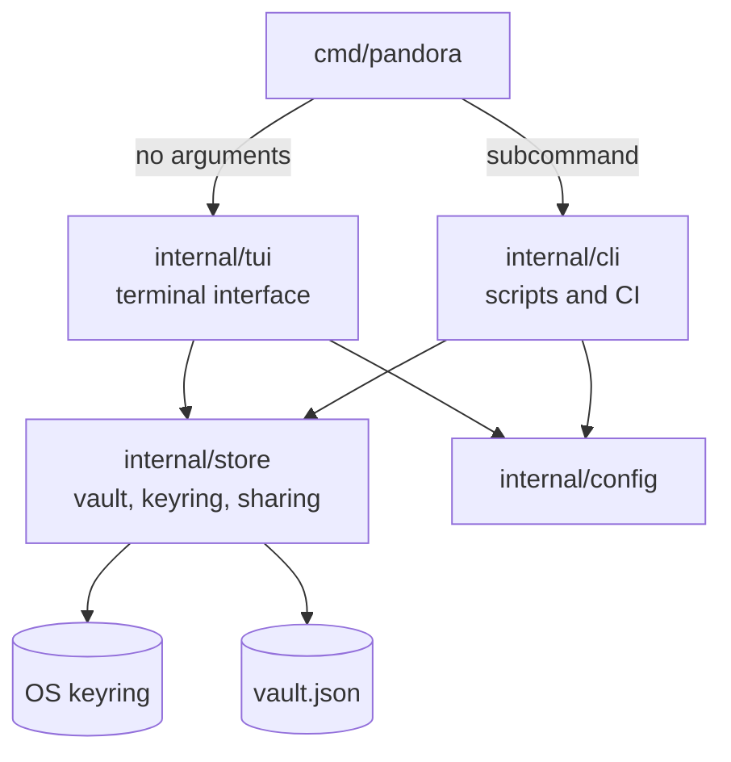

# How Pandora works

## What is stored where

| Data | Where |
| ---- | ----- |
| Secret **values** | The OS keyring, service `pandora-cli`, account = a random 32-hex ID. The stored value is itself encrypted with the data key. Values over about 1.5 KB are split across several entries (`<id>`, `<id>.1`, …) to stay under OS limits. |
| **Names**, categories, user names, notes, tags, dates | `vault.json` in the user config directory, encrypted with the data key. The previous version is kept as `vault.json.bak`, also ciphertext. |
| **Share identity** and trusted peers | Inside `vault.json`, encrypted (see [Sharing](../security/sharing.md)). |
| **Audit log** (optional) | `audit.log`, one encrypted line per action (see [History and audit log](../guides/history-and-audit.md)). |
| **Settings** | `config.json` next to the vault. Plain text, never contains secrets. |

The user config directory is `~/Library/Application Support` on macOS, `$XDG_CONFIG_HOME` or `~/.config` on Linux and `%AppData%` on Windows.

Because the values are encrypted before they reach the keyring, OS tools show only opaque entries. On macOS, `security find-generic-password -s pandora-cli -w` prints ciphertext, and neither `security dump-keychain` nor the config directory reveals your titles.

## Two keys, one password

Pandora never encrypts your data directly with the master password.

1. A random 32-byte **data key** is generated once, when the vault is created.
2. The master password is stretched with **Argon2id** into a **wrapping key**, which seals the data key. The sealed data key is stored in `vault.json` as `wrapped_key`.
3. The data key encrypts the metadata, every value, the share identity and the audit log.

Changing the master password (`pandora passwd`) only re-wraps the data key, so no value in the keyring needs to be rewritten. The trade-off is described under [known limitations](../security/threat-model.md#known-limitations).

## The session

`Unlock` derives the wrapping key, opens the data key and keeps it in a package-level session in memory. Every operation in the `store` package returns `ErrLocked` without it. `Lock` zeroes it. The interface drops the session after an idle timeout (5 minutes by default, `lock_minutes`) or when you press `L`. Memory wiping is best effort: Go does not guarantee that copies are erased.

## Layers

The interface and the command line talk to the storage layer only, and always by **title**. The storage layer maps a title to its random record ID internally. Export and import files and callers never see IDs. The [architecture notes](../ARCHITECTURE.md) go package by package.

## Write ordering

Every write is ordered so that a failure cannot lose a value:

- A new value is written to the keyring **first**, under a fresh ID, and only then does the vault point at it. If the vault write fails, what was just stored is removed again.
- When a value is replaced, the old keyring entries are removed only **after** the vault points at the new ones.
- Vault writes go through a temporary file in the same directory and an atomic rename, after copying the previous contents to `vault.json.bak`.
- Every mutating operation decrypts the vault first and aborts on error, so a corrupt or tampered vault is never overwritten.
- Writers hold an exclusive OS file lock (`vault.lock`), so two Pandora processes serialise instead of overwriting each other.
