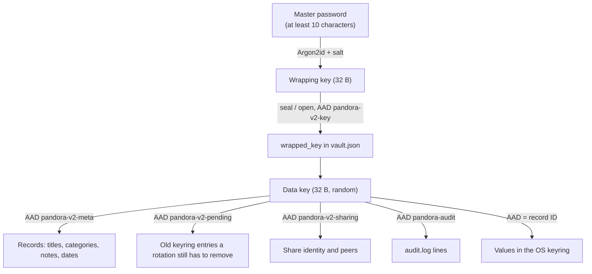

# Cryptography

This page lists every primitive Pandora uses, what each protects, and the parameters. All of it lives in `internal/store` (`vault.go`, `keyring.go`, `chunks.go`, `share.go`, `audit.go`). Pandora uses `golang.org/x/crypto` for Argon2id and XChaCha20-Poly1305, `filippo.io/age` for exports and shares, and the standard library's `crypto/rand`, `crypto/ed25519` and `crypto/sha256`. It implements no primitive itself.

## Summary

| Purpose | Primitive | Parameters |
| ------- | --------- | ---------- |
| Master password to wrapping key | **Argon2id** | time 3, memory 64 MiB, 4 threads, 16-byte random salt, 32-byte output |
| Sealing the data key, the metadata, values, share identity and audit lines | **XChaCha20-Poly1305** | 32-byte key, 24-byte random nonce per seal, a distinct AAD per purpose |
| Randomness (data key, salt, nonces, record IDs, generated secrets) | `crypto/rand` | |
| Passphrase backups (`export --values`) | **age** with a scrypt recipient | ASCII armor, passphrase of at least 10 characters |
| Peer shares (`export --values --to`) | **age** hybrid recipient (ML-KEM-768 + X25519) plus **Ed25519** signature | See [Sharing](sharing.md) |
| Clipboard-clear check | **SHA-256** of the copied value | Compared at expiry; no plaintext is kept |
| Share-key fingerprint | **SHA-256** of the share key, first 16 bytes | Shown as eight groups of four hex digits |

## Key hierarchy



The data key is random and independent of the password. It is generated once with `crypto/rand` when the vault is created, and it does not change when you change your master password. `pandora passwd --rotate-key` replaces it: a new key re-encrypts every value (under new keyring IDs, since the ID is the AAD), the records, the sharing data and the audit log. It also generates a **new share identity** (the peers are kept), so an old copy of the vault cannot open future shares or sign as you.

## Password stretching

The master password is turned into a key with Argon2id (RFC 9106). The parameters are stored next to the salt in `vault.json`:

```json
"kdf": {"alg": "argon2id", "salt": "<b64 16 B>", "time": 3, "memory_kib": 65536, "threads": 4}
```

The file is **untrusted input**. Before any derivation, Pandora requires `alg` to be `argon2id`, `time` between 1 and 10, `memory_kib` between 8 and 1,048,576, `threads` between 1 and 16 and a 16-byte salt. Anything else is rejected, so a crafted vault cannot make Pandora allocate gigabytes or hang.

A wrong password is detected when the wrapped data key fails to authenticate. There is no separate password hash to attack.

The minimum master password length is 10 characters (runes). The strength of the password, not the KDF, is the limit against an offline attacker who has a copy of `vault.json` and your keyring entries.

## Authenticated encryption

Every encrypted blob is `nonce(24) || ciphertext`, where the ciphertext is XChaCha20-Poly1305 with a fresh random nonce. 24-byte random nonces make accidental reuse practically impossible, which matters because Pandora re-encrypts the metadata on every write.

The **associated data** (AAD) binds a ciphertext to its purpose, so one cannot be substituted for another:

| AAD | Protects |
| --- | -------- |
| `pandora-v2-key` | The wrapped data key |
| `pandora-v2-meta` | The records array |
| `pandora-v2-sharing` | The share identity and trusted peers |
| `pandora-v2-pending` | The list of old keyring entries a key rotation could not remove yet |
| `pandora-audit` | One audit-log line |
| the record's 32-hex ID | One secret value (and each history version) |

Binding the **ID** to a value stops an attacker with write access to the keyring from swapping ciphertexts between entries: moving the blob of `secret-a` under the ID of `secret-b` fails to decrypt.

## Values in the keyring

A value is stored as `pv2:` followed by `base64(nonce(24) || XChaCha20-Poly1305(dataKey, value, AAD = id))`. The OS keyrings limit one entry (about 2,560 bytes on Windows Credential Manager, about 4 KB per command on macOS), so the string is split into pieces of at most 2,000 characters, stored under accounts `<id>`, `<id>.1`, `<id>.2`, and so on. The AAD covers the whole concatenation, so reordered, truncated or foreign pieces fail to decrypt.

Record IDs are 32 lowercase hex characters from `crypto/rand`. They carry no information about the title. Replacing a value writes it under a **fresh** ID, so an old ciphertext is never overwritten in place.

## Backups: age with a passphrase

`pandora export --values` encrypts the whole document, titles included, with [age](https://age-encryption.org) using a scrypt passphrase recipient and ASCII armor. The result is a standard age file: `age -d backup.age` can decrypt it without Pandora. Export files are created with mode `0600` and an existing file is only replaced with `--force`.

## Peer shares

A share file combines two layers: a signature by the sender, and age encryption to the recipients. [Sharing](sharing.md) describes the envelope, the signed message and the checks `import` performs.

## Randomness and the generator

All random values come from `crypto/rand`. `pandora gen` and the form's `ctrl+g` draw characters from the chosen set (letters and digits, plus symbols, or hexadecimal) with `crypto/rand`, and print or fill the result without storing it.

## What is **not** protected by these primitives

- A secret in **memory** or on the **clipboard** while you use it. See the [threat model](threat-model.md).
- **Metadata size and timing.** The ciphertext length reveals roughly how many secrets exist and how long their values are, and file modification times show when you changed the vault.
- **Forward secrecy for the vault.** Anyone who later learns the master password can open any copy of `vault.json` they kept, and with a plain `passwd` that copy still unlocks the current keyring values. `--rotate-key` limits this to values that existed before the rotation.
