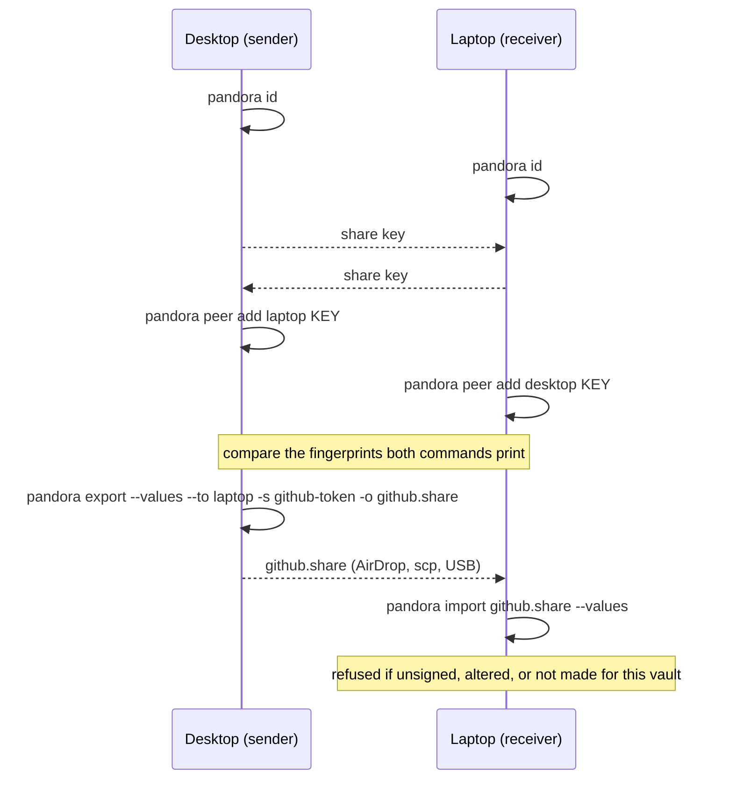

# Sharing secrets between machines

Two vaults that trust each other can exchange chosen secrets as a file, with no passphrase and no network. How the file travels (AirDrop, `scp`, a USB stick) is up to you: the file is useless to anyone but the intended recipient.

## Workflow



1. On each machine, run `pandora id`. It prints the **share key** on stdout and its **fingerprint** on stderr. The identity is created on first use.
2. Move each share key to the other machine. The key is public, so it can travel over any channel. What matters is the next step.
3. On each machine, run `pandora peer add NAME KEY` (the key itself, or a file containing it). Pandora prints the key's fingerprint and asks you to confirm that it matches what `pandora id` printed **on the other machine**. Do this over a channel you trust: in person, on a call, or in a message you can verify.
4. On the sender, run `pandora export --values --to PEER -s TITLE -o FILE`. Repeat `-s` to send several secrets, and `--to` to send to several peers.
5. On the receiver, run `pandora import FILE --values`.

Both machines must have added each other: the sender needs the receiver's key to encrypt, and the receiver needs the sender's key to verify the signature.

## What a share key contains

```text
pandora-share-1:<age hybrid recipient>:<Ed25519 public key, base64url>
```

- an **age hybrid recipient** (ML-KEM-768 combined with X25519), for encryption;
- an **Ed25519 public key**, for verifying signatures.

The matching private halves (the age identity and the Ed25519 seed) are stored in `vault.json`, sealed under your data key with AAD `pandora-v2-sharing`, together with your trusted peers. They are never printed.

The **fingerprint** is the first 16 bytes of the SHA-256 of the share key, as eight groups of four hex digits. It exists so a human can compare two keys quickly and notice a substitution.

## What a share file is

A share file is an ASCII-armored age file. Inside, once decrypted, is a JSON envelope:

```json
{"format": "pandora-share", "version": 1,
 "from": "<sender share key>", "to": ["<recipient share key>", "…"],
 "payload": "<the exported secrets>", "sig": "<Ed25519 signature>"}
```

The signature covers this exact message, with a domain-separation prefix and NUL separators:

```text
"pandora-share-v1" 0x00 from 0x00 to[0] "\n" to[1] … 0x00 payload
```

The recipient list is sorted, and the whole envelope is encrypted with age to every recipient's hybrid key. The envelope is **signed first and encrypted second**, so the recipient list is authenticated: an attacker cannot re-target a share to a different vault.

## What `import` checks

`pandora import FILE --values` writes nothing until all of these hold:

| Check | Refused when |
| ----- | ------------ |
| Decrypts with this vault's identity | The file is not a share, or was made for another vault. |
| Envelope has `format` `pandora-share` and `version` 1 | The file is some other age file. |
| `from` is one of your **trusted peers** | The sender is unknown. The error shows the sender's fingerprint so you can check it. |
| The Ed25519 signature verifies against the peer's stored key | The file was altered, or signed by someone else. |
| This vault's share key is in `to` | The file was not addressed to this vault. |

The payload is then parsed and validated like any import (control characters, size limits, duplicate titles). Existing titles are skipped unless you pass `--overwrite`.

## Security properties

- **Confidentiality.** Only the intended recipients can decrypt. The encryption is hybrid post-quantum: it resists an attacker who records the file today and has a quantum computer later, as long as ML-KEM-768 holds, and it still falls back on X25519 if it does not.
- **Authenticity and integrity.** A recipient accepts a file only if a peer it trusts signed that exact content for it.
- **No passphrase.** There is nothing to type, nothing to reuse and nothing to leak through the environment.
- **No network.** Pandora only reads and writes the file.

## Limits

- **Trust is established by the fingerprint check.** If you skip it, or compare over a channel an attacker controls, you may trust the wrong key. `peer add` refuses to continue without confirmation on a terminal (use `-y` only in scripts that already verified it).
- **No forward secrecy for files.** Anyone who later obtains a recipient's identity can open every share file they kept for it.
- **No revocation list and no replay protection.** A valid share can be imported again. Removing a peer (`pandora peer rm`) stops you accepting new files from it.
- An older Pandora that rewrites the vault **drops the share identity**, so peers must be added again. See the [vault format](vault-format.md#compatibility-rules).
- **`pandora passwd --rotate-key` replaces your share identity.** Your peers are kept, but they hold your old key: they must remove this vault and add it again (`pandora id` shows the new key and fingerprint). Files they encrypted for the old identity can no longer be opened.
